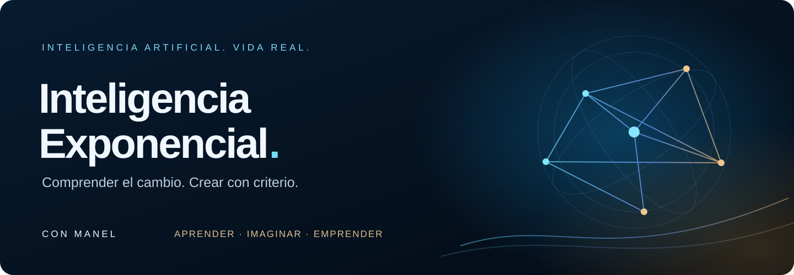
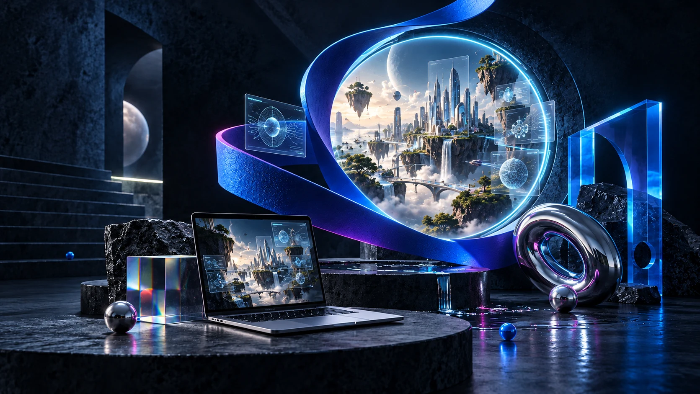

<p align="center">
  <a href="https://trece37.github.io/inteligencia-exponencial/?tema=mina"></a>
</p>

<h3 align="center">Comprender el cambio. Encontrar tu dirección. Empezar a construir.</h3>

<p align="center">
  <a href="https://trece37.github.io/inteligencia-exponencial/?tema=mina"><strong>✦ ABRIR INTELIGENCIA EXPONENCIAL</strong></a>
  &nbsp; · &nbsp;
  <a href="https://trece37.github.io/inteligencia-exponencial/nodo-humano.html"><strong>NODO HUMANO · EMPRESAS Y NUEVAS IDEAS →</strong></a>
</p>

<p align="center">
  
  
  
  
</p>

> **¿Quieres visitar la página?** Usa los accesos de arriba o elige una de las cuatro miradas de abajo. Todos abren la web publicada. Esta página de GitHub presenta el proyecto y su código.

## Inteligencia artificial. Vida real.

El mundo está cambiando. Entender qué ocurre, distinguir lo que se sostiene y descubrir cómo aprovecharlo empieza a formar parte de comprender nuestra propia vida.

**Inteligencia Exponencial** es la propuesta de Manel para aprender a orientarte entre herramientas, agentes y nuevas posibilidades. Para ti, para tus hijos y para la gente que te importa. El aprendizaje parte de tus intereses, tu experiencia y lo que quieres construir.

**Nodo Humano** lleva ese acompañamiento a una empresa o a una idea que quiere ponerse en marcha: comprender la situación, ordenar prioridades, conectar personas y tecnología, y convertir las posibilidades en un siguiente paso concreto.

## Cuatro miradas. Elige por dónde entrar.

<table>
  <tr><th>Inteligencia Exponencial · Editorial</th><th>Inteligencia Exponencial · Mina</th></tr>
  <tr>
    <td><a href="https://trece37.github.io/inteligencia-exponencial/?tema=editorial"></a></td>
    <td><a href="https://trece37.github.io/inteligencia-exponencial/?tema=mina"></a></td>
  </tr>
  <tr><td>Una mirada editorial para explorar, comprender y elegir.</td><td>Azul eléctrico, luz y una invitación a imaginar.</td></tr>
  <tr>
    <td align="center"><a href="https://trece37.github.io/inteligencia-exponencial/?tema=editorial"><strong>ABRIR EDITORIAL →</strong></a></td>
    <td align="center"><a href="https://trece37.github.io/inteligencia-exponencial/?tema=mina"><strong>ABRIR MINA →</strong></a></td>
  </tr>
  <tr><th>Nodo Humano · Oscuro y dorado</th><th>Nodo Humano · Blanco, azul y naranja</th></tr>
  <tr>
    <td><a href="https://trece37.github.io/inteligencia-exponencial/nodo-humano.html"></a></td>
    <td><a href="https://trece37.github.io/inteligencia-exponencial/nodo-humano-claro.html"></a></td>
  </tr>
  <tr><td>Experiencia, estrategia y criterio humano en una atmósfera nocturna.</td><td>La misma propuesta, con una mirada luminosa y abierta.</td></tr>
  <tr>
    <td align="center"><a href="https://trece37.github.io/inteligencia-exponencial/nodo-humano.html"><strong>ABRIR NODO OSCURO →</strong></a></td>
    <td align="center"><a href="https://trece37.github.io/inteligencia-exponencial/nodo-humano-claro.html"><strong>ABRIR NODO CLARO →</strong></a></td>
  </tr>
</table>

Las imágenes son ilustraciones del proyecto. Cada tarjeta abre su versión real, con sus textos, navegación y controles. Son **dos propuestas con dos estilos cada una**, adaptadas a móvil y ordenador.

## Lo que encontrarás

| En Inteligencia Exponencial | En Nodo Humano |
| --- | --- |
| Un relato personal sobre el cambio y nuestra capacidad de decidir. | Acompañamiento para empresas y nuevos proyectos. |
| Historias sobre ciencia, matemáticas, agentes y poder, con fuentes y contexto. | Análisis de la situación y definición de prioridades. |
| Tres demostraciones para explorar creación, comprensión y servicios. | Estrategia, procesos, documentación y coordinación. |
| Un recorrido de aprendizaje que se adapta a cada persona. | Tecnología e IA al servicio de un plan concreto. |
| Vídeo de introducción, narraciones y transcripciones. | Una presentación visual del método y el siguiente paso. |

## Una experiencia que puedes dirigir

- **Vídeo o imagen fija:** pausa, repetición y alternativa estática desde la portada.
- **Tu mirada:** cambia de estilo con el interruptor y navega entre ambas propuestas desde el menú.
- **Texto y voz:** escucha las narraciones o abre sus transcripciones.
- **Móvil y ordenador:** composiciones y medios preparados para ambos formatos.
- **Movimiento a tu medida:** alternativas para movimiento reducido y ahorro de datos.

## El siguiente paso, contigo

Una demostración inicial sin compromiso para ver un ejemplo, comprender qué hay detrás y acordar qué interesa explorar. Las bases están claras; la experiencia de aprendizaje es personal.

Si tienes una empresa o estás dando forma a una idea, [descubre cómo puede acompañarte Nodo Humano](https://trece37.github.io/inteligencia-exponencial/nodo-humano.html).

**El contacto se realiza por el canal en el que ya conoces a Manel.** Esta web no registra reservas ni procesa pagos.

## Dentro del proyecto

Web estática en HTML, CSS y JavaScript, publicada en **GitHub Pages**. Los vídeos y audios se sirven como archivos del sitio; la web no necesita un servidor de aplicación para visitarla.

```text
index.html                    Inteligencia Exponencial · dos temas
nodo-humano.html               Nodo Humano · oscuro y dorado
nodo-humano-claro.html         Nodo Humano · blanco, azul y naranja
manifiesto.html                Relato e intención de Manel
historias/                    Casos, fuentes y contexto
ejercicios/                   Tres demostraciones interactivas
assets/                       Imágenes, avatar, vídeos y audios
docs/media/                   Presentación del repositorio
```

Para trabajar en una copia local, sirve la carpeta con un servidor estático. Por ejemplo, con Python instalado:

```sh
python -m http.server 8080 --bind 127.0.0.1
```

Abre `http://127.0.0.1:8080/`. La publicación usa la rama `main` y la raíz del repositorio. Conserva las rutas relativas y los hashes de la política de seguridad si modificas código inline en los HTML.

## Autoría y medios

Una propuesta independiente de **Manel · trece37**. Las imágenes artísticas creadas con IA se identifican en la web; los materiales de terceros conservan sus créditos y fuentes en las páginas correspondientes. Este repositorio no concede por sí solo una licencia de reutilización del código, las voces o la identidad visual.

<p align="center"><strong>Curiosidad, experiencia y ambición bien enfocada.</strong><br><br><a href="https://trece37.github.io/inteligencia-exponencial/?tema=mina">Entrar en Inteligencia Exponencial →</a> &nbsp; · &nbsp; <a href="https://trece37.github.io/inteligencia-exponencial/nodo-humano.html">Descubrir Nodo Humano →</a></p>
